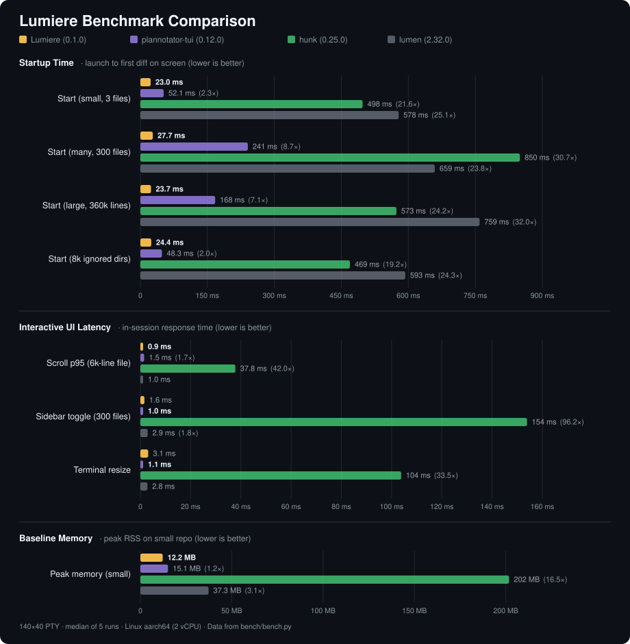
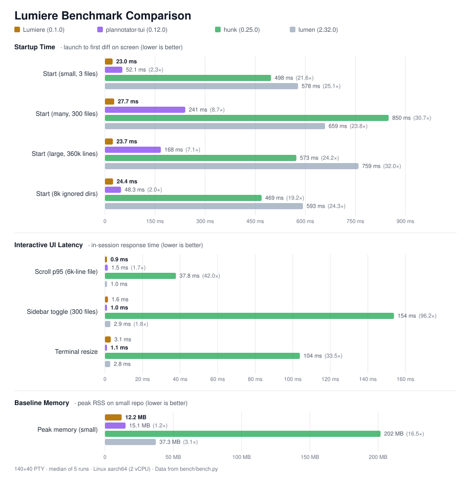

# Comparison

Lumiere sits in a growing ecosystem of terminal diff viewers and review tools. This page compares Lumiere with the tools developers most often evaluate alongside it — including interactive review TUIs, embeddable diff engines, and non-interactive Git pagers — and outlines where each tool is the better fit.

## Feature matrix

| Capability | **Lumiere** | [hunk](https://github.com/modem-dev/hunk) | [plannotator-tui](https://github.com/plannotator/plannotator-tui) | [diffs-rs](https://github.com/plannotator/diffs-rs) | [lumen](https://github.com/jnsahaj/lumen) | [difftastic](https://github.com/Wilfred/difftastic) | [delta](https://github.com/dandavison/delta) | [diff-so-fancy](https://github.com/so-fancy/diff-so-fancy) | [diff](https://www.gnu.org/software/diffutils/) |
| --- | :---: | :---: | :---: | :---: | :---: | :---: | :---: | :---: | :---: |
| Review-first interactive TUI | ✅ | ✅ | ✅ | ✅ | ✅ | ❌ | Partial¹ | ❌ | ❌ |
| Multi-file sidebar & tree | ✅ | ✅ | ✅ | ✅ | ✅ | ❌ | ❌ | ❌ | ❌ |
| Inline review comments / notes | ✅ | ✅ | ✅ | ❌ | ✅ | ❌ | ❌ | ❌ | ❌ |
| Live two-way agent threads in TUI | ✅ | ❌ | ❌ | ❌ | ❌ | ❌ | ❌ | ❌ | ❌ |
| Multi-repo workspace review | ✅ | ❌ | ❌ | ❌ | ❌ | ❌ | ❌ | ❌ | ❌ |
| GitHub PR review | ✅ | ✅ | ✅ | ❌ | ✅ | ❌ | ❌ | ❌ | ❌ |
| Watch mode (live auto-reload) | ✅ | ✅ | ❌ | ❌ | ✅ | ❌ | ❌ | ❌ | ❌ |
| Git & Jujutsu (`jj`) support | ✅ | ✅² | Git only | Git / patch | ✅ | Any | Any | Any | Any |
| Hunks-only & full-file toggle | ✅ | ✅ | ✅ | ✅ | ❌ | ❌ | ❌ | ❌ | ❌ |
| Split & unified / auto layouts | Side-by-side³ | ✅ | ✅ | ✅ | Side-by-side | Split / inline | ✅ | Unified | Unified |
| Mouse support | ✅ | ✅ | ✅ | ✅ | ✅ | ❌ | ❌ | ❌ | ❌ |
| Syntax highlighting | ✅ | ✅ | ✅ | ✅ | ✅ | ✅ | ✅ | ❌ | ❌ |
| Structural (AST) diffing | ❌ | ❌ | ❌ | ❌ | ❌ | ✅ | ❌ | ❌ | ❌ |
| Git pager / stdin patch mode | ❌ | ✅ | ❌ | ✅ | ❌ | ✅ | ✅ | ✅ | ✅ |
| Markdown / plan review & gate | ❌ | ❌ | ✅ | ❌ | ❌ | ❌ | ❌ | ❌ | ❌ |

1. **`delta`** is primarily a Git pager, with an optional interactive `--tui` mode powered by `gitu`.
2. **`hunk`** supports Sapling (`sl`) in addition to Git and Jujutsu.
3. **Lumiere** renders side-by-side by default and lets you focus one panel (`0` old, `-` new, `=` both).

## Performance comparison

End-to-end PTY benchmarks run with [`bench/bench.py`](https://github.com/aduverger/lumiere/blob/main/bench/bench.py) (140×40 terminal, median of 5 runs on a 2-vCPU Linux `aarch64` host, warm page cache) against official `linux-arm64` release binaries. Parentheses show each tool relative to Lumiere (lower is better):

- **Lumiere** `0.1.0` (`lumiere diff`)
- **hunk** `0.25.0` (`hunk diff`, standalone compiled binary)
- **plannotator-tui** `0.12.0` (`plannotator-tui review`, powered by `diffs-rs`)
- **lumen** `2.32.0` (`lumen diff`)

> [!NOTE]
> `diffs-rs` (`diffs`) is a standalone crate/viewer for two-commit diffs and piped patches rather than working-tree reviews, so its engine is benchmarked via `plannotator-tui review` — the full review TUI built on `diffs-rs`. Non-interactive pagers (`difftastic`, `delta`, `diff-so-fancy`, `diff`) do not run an interactive TUI event loop and are omitted from this table.




<div class="comparison-perf">

| Metric | **Lumiere** (`0.1.0`) | **hunk** (`0.25.0`) | **plannotator-tui** (`0.12.0`, `diffs-rs`) | **lumen** (`2.32.0`) |
| --- | ---: | ---: | ---: | ---: |
| Start (`small` repo, 3 files) | **23.0 ms** | 497.6 ms *(21.6×)* | 52.1 ms *(2.3×)* | 578.3 ms *(25.1×)* |
| Peak memory (`small` repo) | **12.2 MB** | 201.8 MB *(16.5×)* | 15.1 MB *(1.2×)* | 37.3 MB *(3.1×)* |
| Start (`small` repo, `--watch`) | **19.4 ms** | 516.2 ms *(26.6×)* | *no watch* | 587.5 ms *(30.3×)* |
| File change to screen (`--watch`) | 508.3 ms³ | **285.1 ms** *(0.6×)* | *no watch* | 305.6 ms⁴ |
| Idle CPU (`--watch`, over 4 s) | **0.0%** | 0.3% | *no watch* | 1.3%⁴ |
| Start (`many` repo, 300 files) | **27.7 ms** | 849.7 ms *(30.7×)* | 240.6 ms *(8.7×)* | 659.1 ms *(23.8×)* |
| First key answered (`many`) | 10.4 ms | 69.9 ms *(6.7×)* | **1.6 ms** *(0.2×)* | 5.1 ms *(0.5×)* |
| Next file (`many`) | 4.6 ms | 12.4 ms *(2.7×)* | **1.0 ms** *(0.2×)* | 5.8 ms *(1.3×)* |
| Sidebar toggle (`many`, 300 files) | 1.6 ms | 153.9 ms *(96.2×)* | **1.0 ms** *(0.6×)* | 2.9 ms *(1.8×)* |
| Start (`many` repo, `--watch`) | **24.7 ms** | 935.2 ms *(37.9×)* | *no watch* | 665.0 ms *(26.9×)* |
| Start (`large` repo, 360k-line file) | **23.7 ms** | 573.3 ms *(24.2×)* | 167.5 ms *(7.1×)* | 759.4 ms *(32.0×)* |
| Open the 360k-line file (`5.3 MiB`) | **166.5 ms** | *skipped¹* | *streamed²* | 5,640.0 ms *(33.9×)* |
| Toggle whole-file view (`5.3 MiB`) | **110.2 ms** | *skipped¹* | *capped (5 MiB)²* | *n/a* |
| Peak memory (`large` repo) | 155.7 MB | 191.6 MB¹ *(1.2×)* | **15.3 MB²** *(0.1×)* | 1,105.6 MB *(7.1×)* |
| Start (`large` repo, `--watch`) | **20.3 ms** | 680.8 ms *(33.5×)* | *no watch* | 761.3 ms *(37.5×)* |
| Start (`ignored` repo, 8k `.venv` dirs) | **24.4 ms** | 469.2 ms *(19.2×)* | 48.3 ms *(2.0×)* | 593.1 ms *(24.3×)* |
| Start (`ignored` repo, `--watch`) | **22.4 ms** | 490.3 ms *(21.9×)* | *no watch* | 990.3 ms *(44.2×)* |
| Scroll step, median (6k-line file) | **0.7 ms** | 1.1 ms *(1.6×)* | **0.7 ms** *(1.0×)* | **0.7 ms** *(1.0×)* |
| Scroll step, p95 (6k-line file) | **0.9 ms** | 37.8 ms *(42.0×)* | 1.5 ms *(1.7×)* | 1.0 ms *(1.1×)* |
| Scroll output (PTY bytes/frame) | 4.2 KB | 4.1 KB *(1.0×)* | **2.2 KB** *(0.5×)* | 6.8 KB *(1.6×)* |
| Terminal resize (`140×40 ↔ 100×30`) | 3.1 ms | 103.8 ms *(33.5×)* | **1.1 ms** *(0.4×)* | 2.8 ms *(0.9×)* |

</div>

1. **`hunk`** does not auto-render the 5.3 MiB file (`File too large to render automatically.`), so `open the large file` and `whole file view` are skipped.
2. **`plannotator-tui`** streams only the unified patch hunks in a continuous view (so `z_large.py`'s first hunk is already on screen at startup with just `15.3 MB` RSS), and caps its whole-file view (`o`) at 5 MiB (`z_large.py is 5.3 MiB; the whole-file view shows files up to 5 MiB.`).
3. **Lumiere** intentionally gathers filesystem events for a 500 ms debounce window (`GATHERING_TIME`) before reloading so atomic editor save-and-rename sequences settle into one reload.
4. **`lumen 2.32.0`** does not ignore `EventKind::Access` events in `--watch` mode, so each reload triggers another reload in a loop — explaining its `1.3%` idle CPU and erratic edit-to-screen timing.

To reproduce on your own machine:

```bash
python3 bench/bench.py run lumiere --tool lumiere --bin target/release/lumiere
python3 bench/bench.py run plannotator --tool plannotator-tui
python3 bench/bench.py run hunk --tool hunk
python3 bench/bench.py run lumen --tool lumen
python3 bench/bench.py compare lumiere plannotator hunk lumen
```

## How they differ & when to choose each

### Lumiere
Built specifically for the **live back-and-forth code-review loop with a coding agent** in the terminal. Choose Lumiere if you want:
- **Two-way inline review threads** where you comment on a hunk or selection and your agent replies directly inside the same thread while the review stays open.
- **Multi-repository workspace reviews** (`api/`, `web/`, …) with per-repo state and single-shot feedback dispatch across repos.
- **A fast, self-contained Rust TUI** with hunks-only default view, live watch mode, GitHub PR viewed-file sync, stacked commits, and native `libgit2` + `jj-lib` support.

### [hunk](https://github.com/modem-dev/hunk)
An interactive diff viewer built on OpenTUI and Pierre diffs. Choose Hunk if you want:
- **Git / Jujutsu / Sapling pager mode** (`git config core.pager "hunk pager"`) and stdin patch viewing.
- **Responsive auto split/unified layouts** or an optional **browser review mode** (`hunk diff --web`).
- **TypeScript extensions** or an embeddable OpenTUI component.
- Hunk supports agent-authored review notes (pushed into a live session via a skill), whereas Lumiere focuses on interactive two-way threads initiated by the human reviewer.

### [plannotator-tui](https://github.com/plannotator/plannotator-tui) & [diffs-rs](https://github.com/plannotator/diffs-rs)
Two closely related Rust + Ratatui projects from the Plannotator ecosystem:
- **`plannotator-tui`** shines when you review **Markdown plans, design docs, and agent transcripts** alongside code diffs, want **scriptable approval gates** (`--gate --require-approval`), or need built-in **Herdr**, **Rex**, and **pi** dispatch. Its code review uses one-way notes/suggestions sent to an agent rather than two-way in-thread replies.
- **`diffs-rs`** is the standalone Ratatui diff viewer and **embeddable Rust crate** powering `plannotator-tui`'s diffs. It is ideal if you want progressive streaming on massive patch files (hundreds of megabytes) from stdin or want to embed a Ratatui diff widget inside your own Rust application.

### [lumen](https://github.com/jnsahaj/lumen)
Lumiere's upstream origin (`v2.32.0`). Choose Lumen if you want built-in **LLM CLI subcommands** (`lumen explain`, `lumen draft`, `lumen operate`) across 10+ AI providers alongside a full-file side-by-side diff viewer. Choose Lumiere if you want hunks-only view by default, multi-repo workspaces, and live two-way coding-agent threads instead of standalone LLM commands.

### [difftastic](https://github.com/Wilfred/difftastic)
A **structural (AST-aware) diff** tool rather than a line-based interactive reviewer. Difftastic excels at comparing refactored code where indentation or formatting changed dramatically; use it as your `git difftool` or pager when structural semantics matter more than interactive review workflows.

### [delta](https://github.com/dandavison/delta), [diff-so-fancy](https://github.com/so-fancy/diff-so-fancy), and GNU [diff](https://www.gnu.org/software/diffutils/)
Classic **stream / pager** tools designed to sit behind `git diff` and `git show` in your scrollback:
- **`delta`** adds rich syntax highlighting, side-by-side or unified output, merge-conflict formatting, and an optional `gitu`-backed `--tui` mode.
- **`diff-so-fancy`** focuses on clean, readable plain-text Git diffs without full syntax highlighting.
- **GNU `diff`** is the ubiquitous POSIX baseline for scripting and patch generation.
